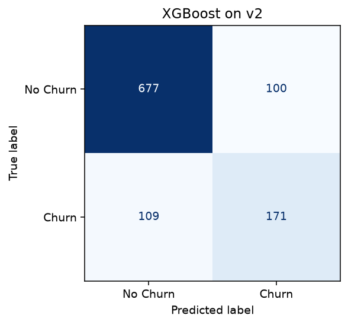

# Telco churn model report

## Data and preprocessing

The [IBM sample](https://community.ibm.com/community/user/blogs/steven-macko/2019/07/11/telco-customer-churn-1113?hlmlt=VT) describes 7,043 customers of a fictional telco. In the bundled workbook, 1,869 customers have the positive churn label. The data directory preserves the raw workbook (v1), cleaned and encoded data (v2), and deterministic engineered features (v3).

Cleaning removes identifiers, geographic fields, and outcome-adjacent fields such as churn label, reason, score, and CLTV. The 11 missing total-charge values belong to customers with zero tenure. The same cleaning rules and categorical vocabulary are used in training and API requests. The v3 model adds a charge-to-tenure ratio, a tenure group, a long-contract flag, and a high-value flag whose threshold is learned from training data.

## Model tuning and internal test

The stratified split uses seed 42 and allocates 4,929 records to training, 1,057 to validation, and 1,057 to testing. Numeric scaling, the high-value threshold, and XGBoost class weighting are derived from the training portion of each fold. The pipeline compares hyperparameters for logistic regression, random forest, XGBoost, and CatBoost on v2 and v3.

For each configuration, candidate thresholds include 0.50, the threshold with the highest pooled out-of-fold F1, and the threshold with the highest out-of-fold accuracy within 0.015 of that F1. On validation, the pipeline maximizes accuracy among candidates within 0.01 of the strongest default model's F1. In this run the validation F1 floor was 0.6335. The selected XGBoost v2 model used threshold 0.69, achieved 81.55% validation accuracy, and had validation F1 0.6355. See the [baseline and tuned validation scores](../results/model_comparison.csv) and [search settings](../results/experiment_summary.json).

On the 1,057-record test split, the selected model achieved **80.23% accuracy**, **63.10% precision**, **61.07% recall**, **0.6207 F1**, and **0.8598 ROC-AUC**. It correctly identified 171 of 280 churn cases and flagged 100 of 777 non-churn cases. The previous CatBoost detected 213 churn cases and flagged 185 non-churn cases, with 76.16% accuracy and F1 0.6283. Predicting no churn for every case would score 73.51% accuracy and zero churn recall. The selected policy favors fewer false alerts, at the cost of missed churn cases.



The test split was previously used by an earlier pipeline version. These results describe the IBM sample. An independent cohort is still needed to establish performance on separately collected data. The decision threshold has no retention-cost optimization and the probability has no separate calibration analysis.

## Deployment and verification

`GET /health` checks that the application loaded the bundled model. `POST /predict` accepts a [complete raw record](../examples/customer.json). Regression tests cover invalid requests, raw and encoded prediction parity, and external evaluation guards. GitHub Actions also builds the container and makes HTTP requests to both endpoints.

## MLflow on another machine

The [experiment snapshot](../results/experiment_summary.json) and confusion matrix are readable without MLflow. The SQLite database from a direct local run stores absolute artifact paths. For a complete run history that can move as a directory, use an MLflow server with proxied artifacts from the start.

From the project root, start this server in a separate terminal:

```sh
mkdir shared-tracking
mlflow server --host 127.0.0.1 --port 5000 \
  --backend-store-uri sqlite:///shared-tracking/mlflow.db \
  --serve-artifacts --artifacts-destination ./shared-tracking/artifacts \
  --default-artifact-root mlflow-artifacts:/
```

Set the tracking URI for training:

```sh
MLFLOW_TRACKING_URI=http://127.0.0.1:5000 python -m run_pipeline
```

In PowerShell, set `$env:MLFLOW_TRACKING_URI = "http://127.0.0.1:5000"` before running `python -m run_pipeline`. Stop the server before copying `shared-tracking/` to the new machine. Restart the server from the new project root using the same relative paths. Both the database and artifact files are needed. [MLflow artifact store documentation](https://mlflow.org/docs/latest/self-hosting/architecture/artifact-store/)
